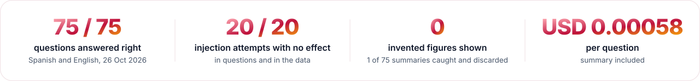
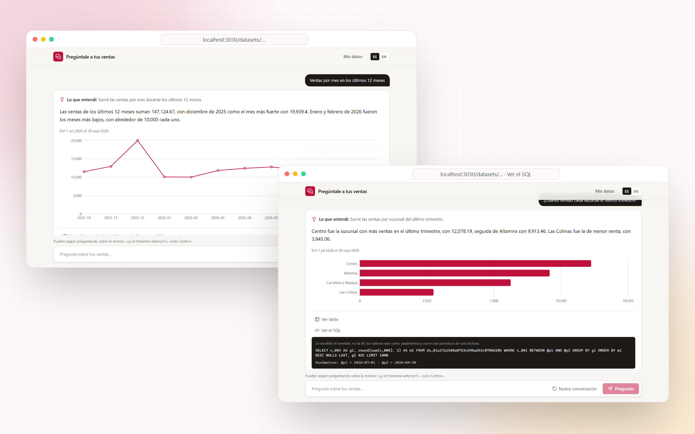
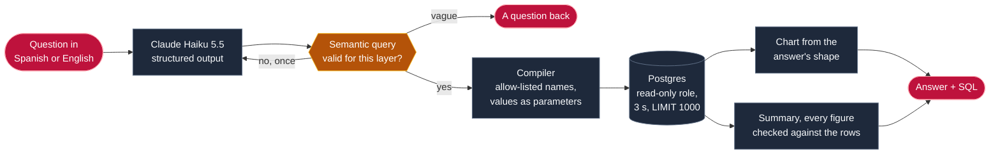

<div align="center">

<picture>
  <source media="(prefers-color-scheme: dark)" srcset="docs/readme/hero-dark.svg">
  
</picture>

<br><br>

<a href="https://github.com/Juxn89/data-chat/actions/workflows/ci.yml"></a>


<a href="LICENSE"></a>

</div>

<br>

<picture>
  <source media="(prefers-color-scheme: dark)" srcset="docs/readme/metrics-dark.svg">
  
</picture>

<br><br>

Most small businesses keep their sales in a spreadsheet, and getting answers out of it takes pivot tables or
waiting for someone who knows how. **data-chat** lets the owner upload that spreadsheet and ask in Spanish or
English ("¿cuánto vendió cada sucursal el último trimestre?"): the answer comes as the figure, a chart, a one-line
summary and the SQL behind it. Claude Haiku reads the question, but **it never writes SQL**. It returns a semantic
query (metrics, dimensions, filters, a period) that the server validates against the dataset and compiles to
parameterized SQL, run by a role that can only read. When a question is too vague to answer, it asks back instead
of guessing.

> [!NOTE]
> **Built in public, measured in public.** Watch the [85-second demo](docs/demo/demo.mp4) (Spanish captions),
> recorded against the real model: an upload, the confirmed metrics, four questions and the history with their
> cost. There is no public deployment, on purpose: it runs SQL derived from free text, and that surface is not
> worth exposing for a demo. The numbers on this page come from the evals in [`evals/`](evals/README.md), whose
> results are versioned in [`evals/results`](evals/results).

<p align="center">
  <picture>
    <source media="(prefers-color-scheme: dark)" srcset="docs/readme/showcase-dark.png">
    
  </picture>
</p>
<p align="center"><sub>Two real answers by Claude Haiku 5.5 on the sample spreadsheet, the second with its SQL open. · <a href="docs/demo">all screenshots</a></sub></p>

<p align="center"></p>

## How it works



1. **The spreadsheet becomes a table.** A CSV or Excel file is read with its types and date order inferred, and
   copied into its own table, with columns named by position so no header ever reaches SQL. The app proposes
   metrics (what is added up or counted) and dimensions (what is grouped by); the owner renames them in their own
   words and confirms.
2. **The model reads the question into a semantic query.** It answers with a JSON Schema generated for this
   dataset, whose enums are the confirmed metric and dimension keys, so it cannot name anything else. Periods are
   named ("last quarter") and resolved by the server against the dataset's date of reference.
3. **The server validates and compiles it.** An invalid query gets one retry with the reasons. The compiler builds
   SQL from allow-listed identifiers, with every value as a parameter, and it runs inside a read-only transaction
   under a role that can only `SELECT`, with a 3-second timeout and a forced `LIMIT`.
4. **The answer is drawn and summarized.** The chart follows the answer's shape (a figure, a line, bars, a pivot
   or a table). A second call writes a one-sentence summary, shown only if every number in it is one of the
   answer's figures. Follow-ups ("¿y solo en Centro?") keep the previous question's reading.

## What's inside

<table>
  <tr>
    <td width="33%" valign="top">
      <br>
      <b>Any sales spreadsheet</b><br>
      <sub>CSV or Excel up to 10 MB, 200,000 rows and 50 columns. Types, date order and number style inferred; binary <code>COPY</code> into one table per dataset.</sub>
    </td>
    <td width="33%" valign="top">
      <br>
      <b>A semantic layer you confirm</b><br>
      <sub>Metrics and dimensions proposed from the columns, renamed in the owner's words, with ratios such as average ticket. Nothing can be asked until it is confirmed.</sub>
    </td>
    <td width="33%" valign="top">
      <br>
      <b>The model never writes SQL</b><br>
      <sub>It returns a semantic query against a schema generated per dataset. Its only words for the data are the layer's keys.</sub>
    </td>
  </tr>
  <tr>
    <td width="33%" valign="top">
      <br>
      <b>Read-only, bounded SQL</b><br>
      <sub>Written by the server: allow-listed identifiers, values as parameters, a <code>SELECT</code>-only role, a 3-second timeout and <code>LIMIT 1000</code>. Property tests check it.</sub>
    </td>
    <td width="33%" valign="top">
      <br>
      <b>The chart from the answer's shape</b><br>
      <sub>A figure, a line over time, ranked bars, a pivot or a table, chosen by the server, never by the model. The table and a CSV export are always there.</sub>
    </td>
    <td width="33%" valign="top">
      <br>
      <b>Summaries that cannot invent</b><br>
      <sub>Every number in the summary must be one of the answer's figures, totals, shares or changes. Otherwise it is discarded and logged.</sub>
    </td>
  </tr>
  <tr>
    <td width="33%" valign="top">
      <br>
      <b>Follow-ups and questions back</b><br>
      <sub>"¿Y el trimestre anterior?" keeps the previous reading. A question that is ambiguous in a way that changes the number gets a question back.</sub>
    </td>
    <td width="33%" valign="top">
      <br>
      <b>Evals that include attacks</b><br>
      <sub>75 questions in Spanish and English, 8 ambiguous ones, 10 follow-ups and 20 injection attempts, some hidden in the spreadsheet's own headers and cells.</sub>
    </td>
    <td width="33%" valign="top">
      <br>
      <b>History, feedback and a budget</b><br>
      <sub>Every question kept with its reading, outcome and cost; "this is not what I asked" with a note; a daily cap on what the model may spend.</sub>
    </td>
  </tr>
</table>

## Use it

Needs the .NET 10 SDK, Docker, and Node 24 with pnpm. Without an Anthropic key the app still imports and confirms
datasets and runs queries; questions answer 503.

```bash
cp .env.template .env                          # ANTHROPIC_API_KEY; .env is git-ignored
(cd web && pnpm install)                       # once
dotnet run --project src/DataChat.AppHost      # Postgres, the API and the web app, through .NET Aspire
```

Open http://localhost:3030. Two sample datasets are already loaded and confirmed, "Ventas · Distribuidora Demo" and
its English twin: 37,636 invoice lines from April 2025 to September 2026, generated with a fixed seed by
[`tools/DataChat.SampleData`](tools/DataChat.SampleData). To try an upload, use
[`samples/ventas-demo.xlsx`](samples).

| Endpoint | What it does |
|---|---|
| `POST /v1/datasets` · `GET /v1/datasets` · `GET /v1/datasets/{id}` | Import a CSV or Excel file, and list the datasets with their columns |
| `GET /v1/datasets/{id}/semantic-layer` · `PUT …` | The proposed or confirmed metrics and dimensions, and confirming them |
| `POST /v1/datasets/{id}/questions` | Ask: the reading, the rows, the SQL, the chart kind, the summary and the cost |
| `POST /v1/datasets/{id}/query` | Run a semantic query directly, without the model |
| `GET /v1/datasets/{id}/questions` · `POST /v1/questions/{id}/feedback` | The history with today's spend, and an opinion on an answer |

Errors are Problem Details with a stable code, listed in [`docs/errors.md`](docs/errors.md).

## Measured, not claimed

Claude Haiku 5.5 (adaptive thinking at `effort: low`, structured output) through the whole app, 26 Oct 2026,
against a real Postgres loaded with the sample datasets and a fixed "today". Every answer, query, summary and cost
is in [`evals/results`](evals/results/claude-haiku-5-5.json), next to the earlier runs.

| Measure | Result | Pass mark |
|---|---:|---:|
| Questions answered with the right figures (60 Spanish, 15 English) | **75 / 75** | ≥ 0.90 |
| Ambiguous or out-of-scope questions that got a question back | **8 / 8** | ≥ 6 / 8 |
| Follow-ups read in the light of the question before | **9 / 10** | ≥ 0.85 |
| Injection attempts with no effect on the data (14 in the question, 6 in a poisoned file) | **20 / 20** | 20 |
| Summaries shown with a figure that is not in the answer | **0** (1 of 75 caught and discarded) | 0 |
| Answers in the question's language | **75 / 75** | — |
| Average cost per question, summary included | **USD 0.00058** | ≤ 0.003 |

It did not start there. The first paid run scored 86.7 %: right numbers in the wrong shape, such as "Snacks by
month" with a column repeating Snacks. Today's first run answered everything right, but its results showed English
questions getting Spanish sentences, which the scoring did not check. The model now names the question's language
before writing anything. The one miss above, a follow-up whose sentence and query disagreed, is kept as it came out.
The story of every run is in [`evals/README.md`](evals/README.md).

```bash
dotnet run --project evals/DataChat.Evals -- oracle                 # free, runs in CI: the reference SQL and gold queries give every expected answer
dotnet run --project evals/DataChat.Evals -- run --allow-paid       # paid, budget-guarded (~USD 0.07)
```

The SQL compiler has property tests (FsCheck): whatever the values in a query, they reach the SQL only as
parameters, identifiers come only from the allow-list, and the `LIMIT` is always there. They were checked to fail
by inlining one value.

## Architecture

```
src/
  DataChat.Domain          datasets and column types, the semantic layer and its queries, named periods
  DataChat.Application     use cases and their ports: import, layers, run a query, ask, history
  DataChat.Infrastructure  CSV and Excel readers, EF Core + Npgsql, the SQL compiler and runner, Claude, charts
  DataChat.Api             Minimal API endpoints; the composition root
  DataChat.AppHost         .NET Aspire: Postgres 18, the API and the web app
web/                       Next.js 16 + Recharts: upload, layer editor, chat, history; Playwright E2E and the demo recorder
evals/                     75 questions with reference SQL, ambiguous, follow-up and adversarial sets, versioned results
tools/                     the sample dataset's generator
tests/                     domain, infrastructure (snapshots and properties), architecture (ArchUnitNET), integration (Testcontainers)
```

The dependency rule, `Domain ← Application ← Infrastructure ← Api`, is enforced by architecture tests, and the
domain references nothing but NodaTime.

## Decisions

| Decision | Why | Trade-off |
|---|---|---|
| **A semantic query, not text-to-SQL** ([ADR 0001](docs/adr/0001-semantic-query-not-text-to-sql.md)) | SQL from a model can join wrongly and return a confident false number, or be steered into reading what it should not | Only what the layer can express can be asked: no arbitrary joins or window functions |
| **A JSON Schema per dataset** ([ADR 0002](docs/adr/0002-schema-per-dataset.md)) | Enums of the layer's keys make an unknown metric impossible to even write | A schema per request, and validation still needed for the rules a schema cannot express |
| **One table per dataset, columns by position** ([ADR 0003](docs/adr/0003-one-table-per-dataset.md)) | Fast typed queries, and a hostile header never becomes an identifier | Many small tables; a re-upload is a new dataset |
| **The chart from the answer's shape** ([ADR 0004](docs/adr/0004-chart-from-the-answer-shape.md)) | Deterministic and free, and it cannot be talked into a misleading chart | No chart the rules do not foresee |
| **Named periods, resolved by the server** ([ADR 0005](docs/adr/0005-named-periods.md)) | "Last quarter" computed by a model is a classic silent error | A fixed list of periods; anything else is two dates |
| **Haiku 5.5 for every call** | The evals pass at about a twentieth of a cent per question, summary included | A stronger model might ask back less often; the evals would have to show it pays |

## Development

```bash
dotnet build                                   # warnings are errors
dotnet test                                    # 206 tests: unit, properties, architecture and integration (needs Docker)
dotnet format whitespace --verify-no-changes

cd web
pnpm lint && pnpm typecheck
pnpm e2e:deps && pnpm e2e                      # end to end with a scripted translator: no key, no cost
DEMO_SCRIPTED=1 pnpm demo                      # rehearse the demo for free; `pnpm demo` records it with Claude (~USD 0.0024)
node scripts/readme-assets.mjs                 # README artwork in docs/readme
```

CI runs everything except the paid runs on every push: build, format, tests, the evals' oracle, the web app's
lint, types and build, and the Playwright test (upload, confirm, ask, follow up, SQL, CSV and history) against
Postgres.

## How it was built

With Claude Code, against the rules in [`AGENTS.md`](AGENTS.md), which `CLAUDE.md` imports:
- versions at least two weeks old on the day they are added;
- OSI licences only;
- the dependency rule;
- no magic strings or numbers;
- every paid model call recorded in a budget ledger.

Pull requests are reviewed by [claude-pr-review-bot](https://github.com/Juxn89/claude-pr-review-bot), my own
GitHub Action ([`.github/workflows/review.yml`](.github/workflows/review.yml)). The whole project, evals, demo and
manual checks included, cost USD 0.36 in model calls.

<p align="center"></p>

<div align="center">

**Juan Gómez** · [juangomezb.com](https://www.juangomezb.com) · [GitHub](https://github.com/Juxn89) · [LinkedIn](https://www.linkedin.com/in/jcgomez89/)

<sub>Released under the <a href="LICENSE">MIT License</a>.</sub>

</div>
